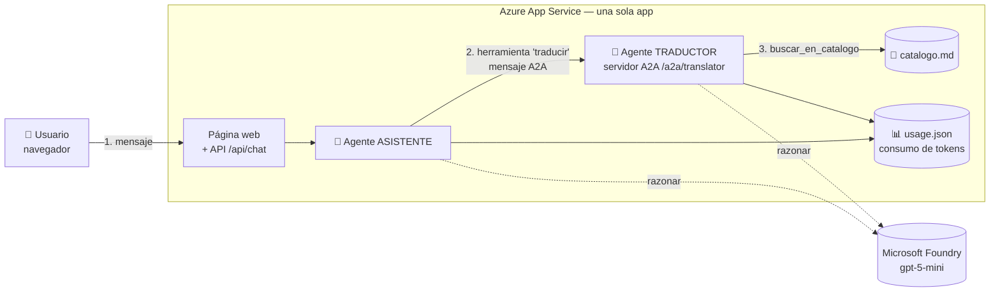

# Documento técnico de arquitectura — Traductor Maya

> Escrito para personas con poca experiencia. Al final hay un [glosario](#glosario).

## 1. Vista general

Toda la solución es **una sola aplicación web** en Python, desplegada en **Azure App Service**. Dentro viven dos agentes de IA que usan un modelo de **Microsoft Foundry**.



**Flujo de una traducción**

1. El usuario escribe *"¿cómo se dice perro?"*. La página lo envía a `/api/chat`.
2. El **asistente** entiende que es una traducción y usa su herramienta `traducir`, que envía un **mensaje A2A** al traductor.
3. El **traductor** llama a `buscar_en_catalogo(["perro"])`. Esa búsqueda la hace **Python** (no la IA), así que es exacta y no gasta tokens.
4. El traductor responde por A2A con el resultado (`perro (es) → peek'`), y el asistente se lo presenta al usuario.
5. Cada agente anota sus tokens en `usage.json`. La página muestra el consumo actualizado.

## 2. Componentes

| Pieza | Archivo | Qué hace |
|---|---|---|
| Configuración | `app/config.py` | Lee todas las variables de entorno (`.env`). Nada depende de una cuenta fija. |
| Cliente del modelo | `app/llm.py` | Crea la conexión a Foundry. Permite 3 modos: `foundry` (identidad), `key` (API key) o `fake` (simulado). |
| Catálogo | `app/catalog.py` + `data/catalogo.md` | Lee la tabla Markdown y busca palabras ignorando acentos, mayúsculas y variantes del saltillo. |
| Agente traductor | `app/translator_agent.py` | Agente con la herramienta `buscar_en_catalogo`, publicado como **servidor A2A** con su *Agent Card*. |
| Agente asistente | `app/assistant_agent.py` | Agente que conversa; su herramienta `traducir` es un **cliente A2A** del traductor. |
| Registro de consumo | `app/usage_store.py`, `app/tracking.py` | Guarda tokens por agente, por sesión, por día e histórico en un JSON. |
| Web y API | `app/main.py`, `app/static/index.html` | FastAPI: página, `/api/chat`, `/api/usage`, límites y clave de acceso. |

**Librerías principales** (las del curso): `agent-framework` (agentes), `agent-framework-foundry` (conexión a Foundry), `agent-framework-a2a` + `a2a-sdk` (protocolo A2A), `azure-identity` (inicio de sesión sin claves), `fastapi` + `uvicorn` (servidor web).

## 3. ¿Cómo funciona el A2A aquí?

**A2A** es un protocolo estándar para que un agente le pida trabajo a otro, como dos servicios web que se envían mensajes.

- El traductor publica una **tarjeta** en `/a2a/translator/.well-known/agent-card.json`. Dice quién es, qué sabe hacer y dónde recibe mensajes.
- El asistente **lee esa tarjeta** la primera vez (descubrimiento) y después envía mensajes JSON‑RPC a `/a2a/translator/`.
- La dirección del traductor está en `TRANSLATOR_A2A_URL`. Hoy apunta a la misma app; mañana puede apuntar a otro servidor **sin cambiar código**.
- La ruta A2A está protegida con una clave interna (`A2A_INTERNAL_KEY`, cabecera `X-A2A-Key`): nadie de fuera puede usar al traductor.
- Junto con cada mensaje viaja el **id de la sesión** del chat (metadatos A2A), para sumar el consumo del traductor a la sesión correcta.

## 4. Decisiones para ahorrar consumo

| Decisión | Por qué ahorra |
|---|---|
| Búsqueda del catálogo en Python | La IA no recibe las 200 palabras en cada mensaje; solo el resultado. |
| Modelo `gpt-5-mini` con razonamiento `minimal` | Modelo económico y con pocos tokens de "pensamiento". |
| `MAX_OUTPUT_TOKENS=600` | Tope a cada respuesta. |
| `HISTORY_TURNS=2` | Solo se reenvían los últimos 2 turnos de conversación. |
| Límites por sesión y por día + clave de acceso | Nadie puede gastar los créditos sin control. |
| Un solo App Service (plan F1 gratuito) | Ambos agentes comparten servidor: no se paga doble hospedaje. |
| Sin base de datos | Un archivo JSON en `/home/data` (carpeta persistente de App Service). |

**Costo estimado:** `tokens de entrada × PRICE_INPUT_PER_1M / 1 000 000 + tokens de salida × PRICE_OUTPUT_PER_1M / 1 000 000`. Precios configurables (por defecto, gpt-5-mini: 0.25 y 2.00 USD por millón).

## 5. Configuración (cambiar de cuenta)

Todo está en variables de entorno; la lista completa y comentada está en [`.env.example`](../.env.example). Para usar **otra cuenta de Azure** solo cambias:

- `FOUNDRY_PROJECT_ENDPOINT` → el endpoint del nuevo proyecto.
- `ASSISTANT_MODEL` / `TRANSLATOR_MODEL` → el nombre del despliegue del modelo.
- (y en App Service, volver a asignar el rol a la identidad administrada).

## 6. Seguridad

- **Sin secretos en el repositorio:** `.env` está en `.gitignore`. En Azure, la app usa **identidad administrada** para hablar con Foundry: no hay API keys que robar.
- **Clave de acceso** (`APP_ACCESS_KEY`) para usar el chat y **clave interna** para el A2A.
- **Sin internet** por defecto. Si se configuran `ALLOWED_SITES`, el traductor solo puede leer páginas `https://` de esos dominios.

## Despliegue en Azure App Service

Recursos usados:

| Recurso | Nombre | Notas |
|---|---|---|
| Suscripción | Azure for Students | 100 USD de crédito |
| Grupo de recursos | `rg-osw_ariel-ia-3954` | |
| Recurso Foundry / proyecto | `osw-ariel-ia-0227-resource` / `osw-ariel-ia-0227` | North Central US |
| Modelo | despliegue `gpt-5-mini` | Global Standard, pago por uso |
| App Service | plan Linux **F1** (gratis), Python 3.12 | identidad administrada con rol *Azure AI User* |

Pasos (desde Azure Cloud Shell, ver también [`desplegar-app-service.prompt.md`](../.github/prompts/desplegar-app-service.prompt.md)):

```bash
git clone https://github.com/<usuario>/<repo>.git && cd <repo>
APP=traductor-maya-$RANDOM; RG=rg-osw_ariel-ia-3954
az webapp up -n $APP -g $RG -l northcentralus --runtime PYTHON:3.12 --sku F1
az webapp identity assign -n $APP -g $RG
# Rol para que la app use Foundry sin claves
az role assignment create --assignee $(az webapp identity show -n $APP -g $RG --query principalId -o tsv) \
  --role "Azure AI User" --scope $(az cognitiveservices account show -n osw-ariel-ia-0227-resource -g $RG --query id -o tsv)
az webapp config appsettings set -n $APP -g $RG --settings LLM_PROVIDER=foundry \
  FOUNDRY_PROJECT_ENDPOINT=<endpoint> ASSISTANT_MODEL=gpt-5-mini TRANSLATOR_MODEL=gpt-5-mini \
  DATA_DIR=/home/data PORT=8000 A2A_INTERNAL_KEY=<clave-larga> APP_ACCESS_KEY=<clave> SCM_DO_BUILD_DURING_DEPLOYMENT=true
az webapp config set -n $APP -g $RG --startup-file "startup.sh"
```

## 7. Cómo crecer después

- **Más agentes:** agregar, por ejemplo, un agente de pronunciación o de cultura maya con su propio servidor A2A; el asistente solo necesita una herramienta nueva.
- **Traductor separado:** desplegarlo en otro servicio y cambiar `TRANSLATOR_A2A_URL`.
- **Base de datos:** reemplazar `UsageStore` (un solo archivo) por Azure Table Storage o Cosmos DB.
- **Catálogo más grande:** pasar del `.md` a Azure AI Search si crece a miles de palabras.
- **Interfaz bilingüe:** los textos de la página están en un solo archivo para traducirlos.

## Glosario

| Término | Significado sencillo |
|---|---|
| **Agente** | Programa que usa un modelo de IA para decidir qué hacer y puede usar herramientas. |
| **A2A** | *Agent-to-Agent*: protocolo estándar para que un agente le pida algo a otro. |
| **Agent Card** | "Tarjeta de presentación" en JSON que describe a un agente A2A y su dirección. |
| **Herramienta (tool)** | Función de Python que el agente puede llamar (por ejemplo, buscar en el catálogo). |
| **Token** | Pedacito de texto con el que se mide y cobra el uso del modelo. |
| **Microsoft Foundry** | Plataforma de Azure para usar modelos de IA y construir agentes. |
| **Despliegue (deployment)** | Una copia del modelo lista para usar en tu proyecto, con un nombre (aquí `gpt-5-mini`). |
| **App Service** | Servicio de Azure que hospeda aplicaciones web. |
| **Identidad administrada** | "Usuario" que Azure le da a la app para entrar a otros servicios sin contraseñas. |
| **Variable de entorno** | Valor de configuración que se da a la app desde fuera del código (archivo `.env`). |
